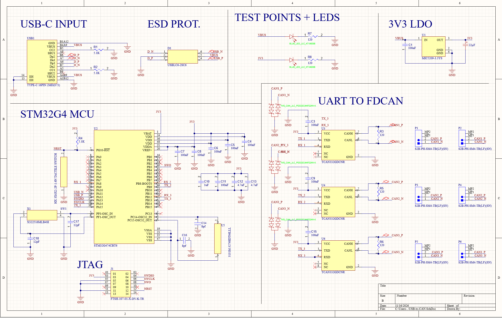
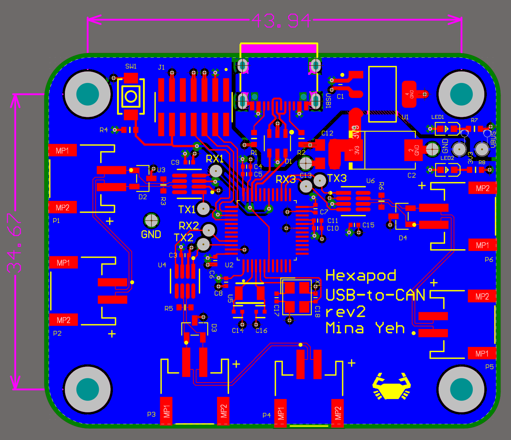
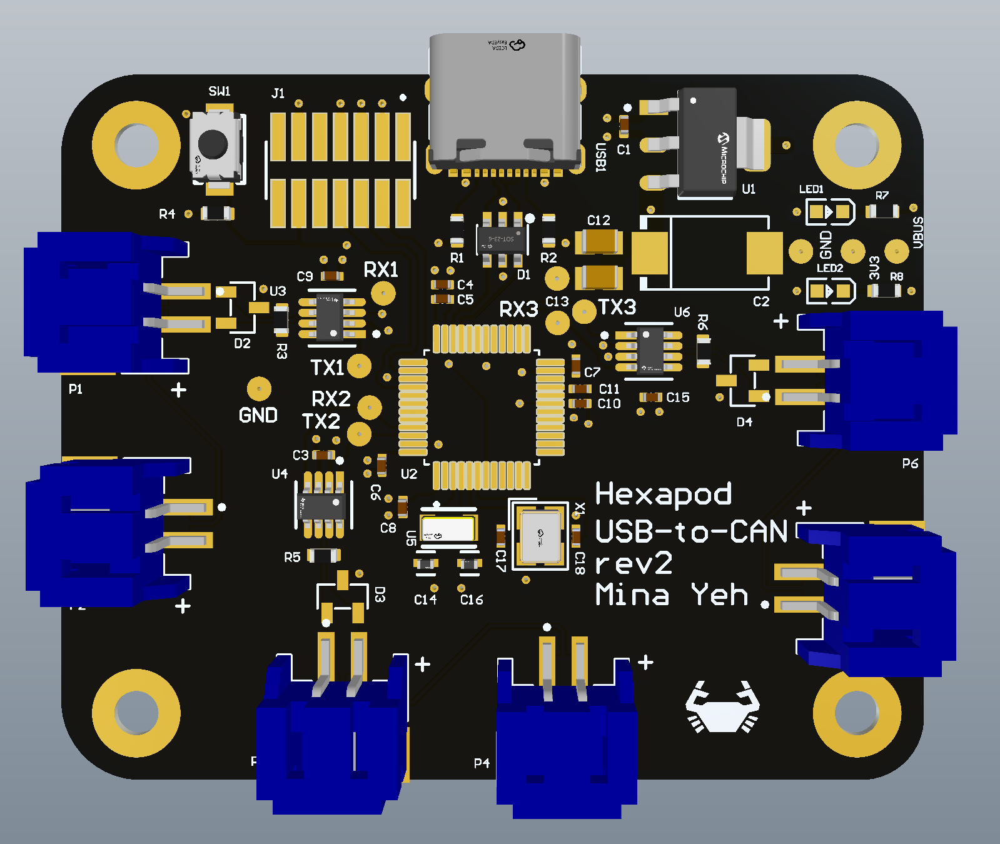
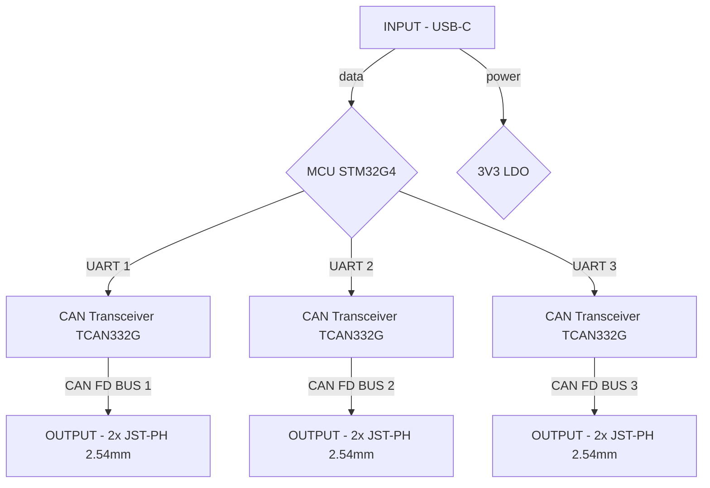
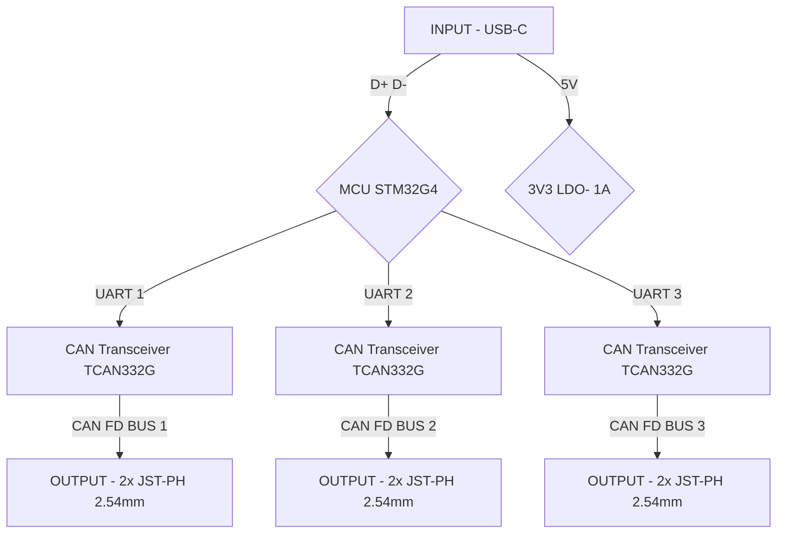
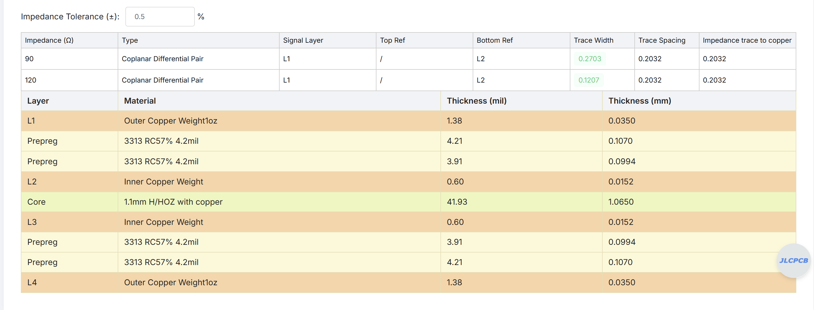

# HEXAPOD - USB-to-CAN V2

**Part:** CUPI - HEXAPOD - USB-to-CAN PCB  

**Rev:** V2

**Owner:** Mina Yeh 

**Status:** Completed

Takes USB-C input from the Jetson t5000 and converts to three FDCAN buses. 

## Requirements

- Input: USB-C data & 5V power from the Jetson Nano
- Output: 6 JST-PH 2.54mm plugs (CAN_H & CAN_L) (Three separate buses.)
- M2.5 Mounting Holes
- Dimensions: 40mm x 50mm

## Design

## System Diagrams
### Functional Block Diagram

3V3 LDO supplies power to all components. 
### Structural Block Diagram

3V3 LDO supplies 3V3 power to all relevant components (MCU, CAN Convertors). 
## Notes

https://jlcpcb.com/pcb-impedance-calculator

