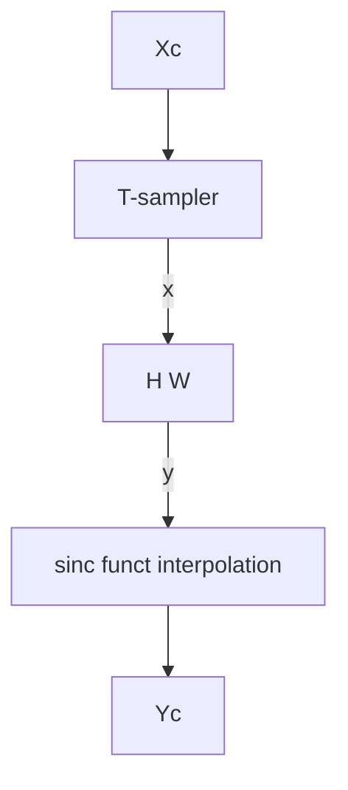

# DFT & FFT

## Classic DSP Paradigm
### Problem
Given continuous-time LTI system w/impulse response $h$ and frequency response $\hat{H}$, we want to approximate it in discrete time mediated by sampling, interpolation, etc. 

Overall, we need to pick $T>0$ and a discrete-time system with impulse response $h$ and frquency response $\hat{H}$ such that 

Which appoximately implements 

$$X_c \rightarrow \boxed{\hat{H}(\Omega)} \rightarrow Y_c$$

Assume all relevant $X_c$s are bandlimited, bandwidth $\leq \Omega_m^*$, and $\frac{2\pi}{T} > 2\Omega_m^*$, (pick a small enough positive T that this holds). 

Suppose $X_c \xrightleftarrow{\mathcal{F}} \hat{X}_c$. By equation D, we have 
