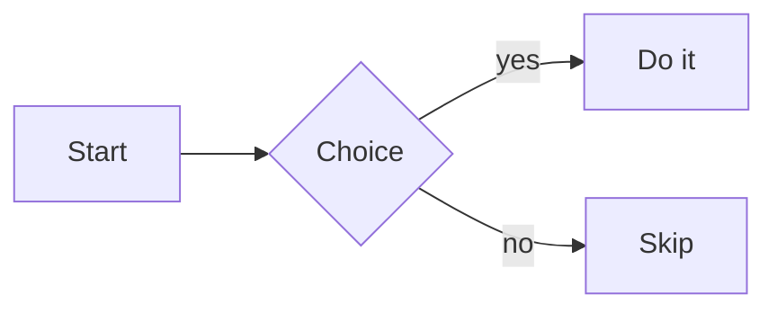

# How to add notes

1. **New note**: create a `.md` file anywhere inside `notes/`. The dev server picks it up instantly.
2. **New folder**: create a folder inside `notes/` and put files in it. Nesting is unlimited.
3. **Title**: the first `# Heading` is the display title (otherwise the file name).
4. **Frontmatter** (`---` block at the top) is allowed and ignored.

## Links
- `[[Note Name]]` or `[[Folder/Note Name]]` (case-insensitive; a bare name matches any folder)
- `[[Note Name|custom text]]` for an alias
- Dotted grey links point to notes that don't exist yet
- Backlinks and outgoing links are listed in the right panel

## Media
Drop images, GIFs or videos (`png jpg gif webp svg mp4 webm mov`) anywhere in `notes/`, then:
- `![[photo.png]]` or `![[photo.png|300]]` (300 = width in px), found by file name
- `` (relative to the note) or any `https://` URL
- Video: `![[clip.mp4]]`; YouTube links are embedded as a player

## Code
Fenced blocks with a language are syntax highlighted. See [[Demo/Markdown and Code]].

## Quizzes
~~~
```quiz
Q: What is 2 + 2?
- [ ] 3
- [x] 4
? Basic arithmetic.
```
~~~
One `[x]` renders radio buttons; several render checkboxes. Try it in [[Demo/Quiz]].

## Flow diagrams
Use a fenced block with the language `mermaid`:

~~~

~~~
See [[Demo/Flow Diagram]] and the Mermaid docs for every diagram type.

## Homepage
`notes/_home.md` is the homepage. Files whose name starts with `_` are not notes: they stay out of the graph, sidebar and backlinks. An automatic index of all notes is appended to the homepage.

## Callouts
~~~
> [!note] Optional title
> Body text with **markdown** and [[links]].
~~~
Types: `note` `tip` `info` `warning` `danger` `success` `quote`. See [[Demo/Callouts Tags Math]].

## Tags
Write `#tag` anywhere (not inside code). Tags are clickable, indexed on the homepage, listed on their own page, and the Graph tab has a tag filter. Nested tags like `#area/topic` work.

## Embedding notes
`![[Other Note]]` pulls that note's content inline. `![[photo.png]]` embeds media as before.

## Math
Inline `$E = mc^2$` and block math between `$$` lines (KaTeX). A `$$` block may also start mid-line or be written on one line (`$$x^2$$`). Write `\$` for a literal dollar sign (otherwise `$5 and $10` is read as math). Inside math, write a literal hash as `\#`.

## Quizzes: extras
Fill-in-the-blank uses `A:` with accepted answers separated by `|`. Add `Shuffle: yes` to randomize option order.
~~~
```quiz
Q: Water is hydrogen and ____.
A: oxygen | O
? H2O
```
~~~
Every note with quizzes shows a running score with a reset button.

## Navigation
- **Ctrl/Cmd+K** (or `/`, or the magnifier button) opens the quick switcher.
- Graph: scroll or pinch to zoom, drag the background to pan, drag nodes. Colours follow top-level folders.
- Prev/next links at the bottom of each note follow the sidebar order.
- Unresolved `[[links]]` are listed at the bottom of the homepage.

See also [[Customize and Deploy]].
